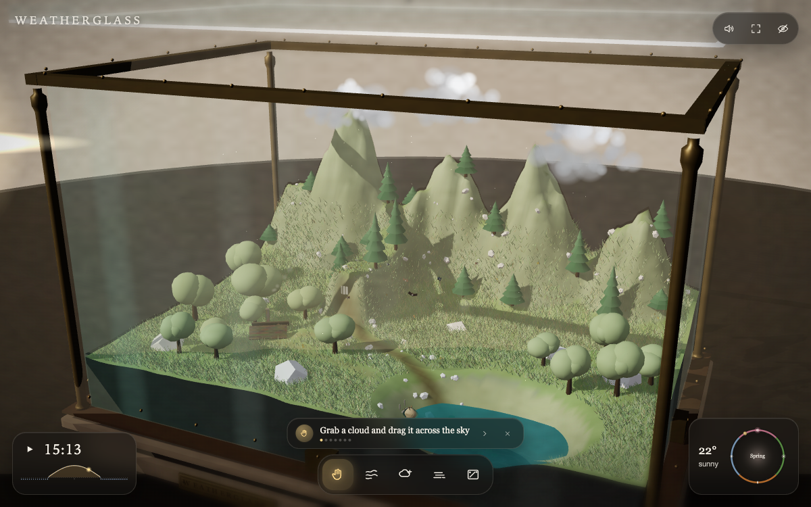

# Weatherglass

**A self-contained interactive 3D weather toy — a living miniature landscape sealed inside a brass-and-glass display case on a walnut plinth.**

> **Built by:** version **GLM5.3 Flash (EXL3 Weight, Max Effort)** on **DGX Spark x2**
> **Build time:** **55 minutes**
> One HTML file. Zero external images, models, fonts or audio — every texture, mesh, sound and UI element is generated in code at runtime.

**Live:** https://todsawat.github.io/weatherglass/

## What it is

A 12 × 8 × 9.2 m miniature valley — mountains, waterfall, river, lake, cabin, jetty, rowboat, grass, seasonal flowers, birds, fish, fireflies — held inside a working glass case with brass posts, rails, rivets, a walnut plinth and an engraved plaque with a live humidity/temperature gauge.

Clouds are fully physical objects: grab them, squeeze them, shake them, fling them, smash them together to merge them. Squeeze hard enough and it rains. Shake one and lightning cracks inside it. Drip water onto it and it grows. Wind blows it around. Fog pours in low. Rain beads on the glass, frost creeps across it in winter, and a cloth wipes it clean. Drag the sun or the moon across the sky; the seasons turn continuously and the whole diorama follows.

## Controls

- **Drag** empty space — orbit. **Scroll / pinch** — zoom.
- **Grab** — drag a cloud. While holding it: **squeeze** (secondary drag / wheel) to wring it out, **shake** it for lightning, **fling** it, or press it into another cloud to merge.
- **Wind** — swipe to push clouds and foliage.
- **Cold** — chill the glass; drip condensation, then wipe with the cloth.
- **Fog** — pour low fog.
- **Sun / time** — drag the sun or moon along the arc; scrub the day curve; the season dial drives foliage, flowers and weather.
- **`1`–`5`** or **`H W C F G`** — pick a tool. **`U`** — hide the UI. **`R`** — reset the view.
- On first load a short coach sequence walks through each interaction.

### Scenarios

Append `?scenario=` to the URL:
`calm` · `rain` · `storm` · `snow` · `mountainsnow` · `fog` · `autumn` · `night` · `dusk`

Example: https://todsawat.github.io/weatherglass/?scenario=storm

## Notes

- Single file `index.html`, WebGL2 required, works on desktop and mobile (responsive canvas + touch drawer).
- Performance auto-tiers itself (grass 20k / 60k / 120k by measured frame time).
- Original brief included in [PROMPT.md](PROMPT.md).
